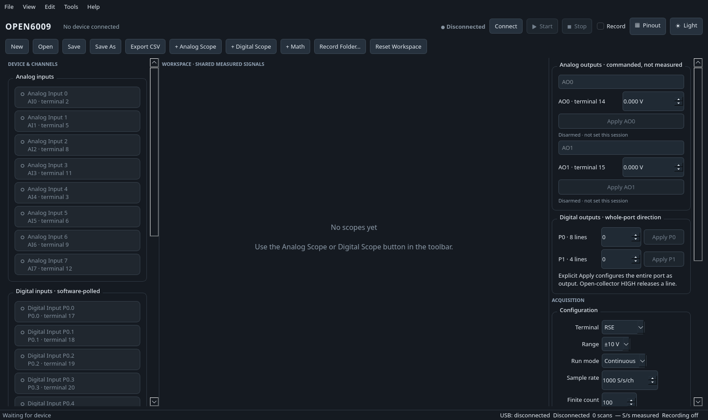

# Open6009

Open6009 is an independent native Linux driver and desktop instrument for the
National Instruments USB-6009 data-acquisition device (`3923:717b`). It uses
the system `libusb-1.0` library directly: NI-DAQmx, NI-VISA, Windows, and a
virtual machine are not required.



## Features

- Finite and continuous calibrated analog acquisition.
- All eight RSE analog inputs at ±10 V.
- Four differential input pairs with the device's supported ranges.
- Multichannel scan acquisition up to the 48 kS/s aggregate device limit.
- Asynchronous, multi-transfer EP2 streaming with bounded display buffers.
- Software-polled input for P0.0–P0.7 and P1.0–P1.3.
- Whole-port open-collector digital output control.
- AO0 and AO1 control from 0–5 V using calibration read from the device.
- CTR0 falling-edge start, read, and stop operations.
- Live Qt/PySide6 workspace with analog and digital scopes, CSV recording,
  projects, math channels, pinout reference, and light/dark themes.
- A native command-line interface for automation and diagnostics.

Open6009 never contains or performs firmware-update, EEPROM-write, or
calibration-memory-write operations.

## Requirements

- Linux with `libusb-1.0`
- Python 3.11 or newer
- A user account permitted to access the USB-6009 device node

On Arch Linux:

```bash
sudo pacman -S --needed python libusb
```

Debian/Ubuntu equivalents are `python3`, `python3-venv`, and `libusb-1.0-0`.

## Install

Clone or download the repository and run the per-user installer:

```bash
cd Open6009
./install.sh
```

The installer creates an isolated `.venv`, installs the Python application,
and adds Open6009 to the desktop application menu. It does not require root.

### USB permissions

If the application reports permission denied, review and install the supplied
udev rule:

```bash
sudo install -Dm644 packaging/70-open6009.rules \
  /etc/udev/rules.d/70-open6009.rules
sudo udevadm control --reload-rules
sudo udevadm trigger --subsystem-match=usb
```

Then unplug and reconnect the USB-6009. The rule uses `TAG+="uaccess"` and does
not grant access to unrelated USB hardware.

## Run

Start Open6009 from the application menu or from the repository:

```bash
./run-open6009
```

The GUI does not claim the device until **Connect** is pressed and never changes
an output merely because a panel is opened.

1. Press **Connect**.
2. Click one or more analog or digital channel cards to enable them.
3. Add an **Analog Scope** or **Digital Scope**.
4. Choose finite or continuous acquisition settings.
5. Press **Start**. Press **Stop** before changing wiring.

The eye icon beside a scope signal hides only that trace. Its live numeric
readout continues to update. Use **Pinout** for a fixed 32-terminal reference;
**Locate on device** flashes the selected terminal.

## Recording

Enable **Record** before starting analog acquisition and choose a new CSV file.
Open6009 writes raw data to a partial sidecar while acquisition is active, then
publishes the CSV and raw file only after successful cleanup. An interrupted
recording is never presented as complete.

## Command line

List devices and check permissions:

```bash
.venv/bin/open6009 devices
.venv/bin/open6009 diagnose
```

Acquire 1,000 calibrated AI0 samples at 1 kS/s:

```bash
.venv/bin/open6009 acquire ai0 --rate 1000 --samples 1000 \
  --raw-output ai0.raw --csv-output ai0.csv --execute-native
```

Capture bounded continuous AI0+AI1 data:

```bash
.venv/bin/open6009 stream ai0,ai1 --rate 1000 --chunks 20 \
  --raw-output ai01.raw --csv-output ai01.csv --execute-native
```

Hardware-changing CLI commands require `--execute-native`:

```bash
.venv/bin/open6009 digital-read 0 --execute-native
.venv/bin/open6009 digital-write 0 0xff --execute-native
.venv/bin/open6009 ao-set 0 1.25 --execute-native
.venv/bin/open6009 counter-read --execute-native
```

Digital outputs are open collector: a logical high releases the line. Do not
connect external signals or loads without respecting the USB-6009 electrical
limits and a shared ground.

## Python API

```python
from open6009.acquisition import AnalogInputConfig, TerminalMode
from open6009.device import Usb6009

config = AnalogInputConfig(
    channels=(0,),
    mode=TerminalMode.RSE,
    voltage_range=10.0,
    samples_per_channel=100,
    rate_per_channel=1000,
)

with Usb6009.open() as device:
    batch = device.acquire_analog_volts(config, explicitly_authorized=True)
    for scan in batch.scans_volts:
        print(scan[0])
```

The explicit authorization argument prevents accidental hardware activity in
scripts that merely construct a driver object.

## Supported configurations and limitations

- Continuous analog acquisition currently supports RSE ±10 V. Differential
  acquisition is finite.
- Finite acquisitions are bounded to 4,096 scans and ten seconds per operation.
- Combined analog/digital mode timestamps digital values on the host; it is not
  hardware-timed digital sampling.
- Digital direction is configured per port. Mixed input/output direction within
  one port is not supported.
- Digital-only and combined digital data are not included in analog CSV files.
- AO command execution and counter reads are implemented; final electrical
  accuracy should be verified for the user's wiring and load.
- Only one attached USB-6009 is opened at a time. If multiple devices are
  connected, disconnect extras before using the GUI.

Run `.venv/bin/open6009 diagnose` first when troubleshooting discovery or
permissions.

## Safety

Disconnect external signals before changing terminal configuration. Stay within
the voltage/current limits in the official USB-6009 hardware guide. Open6009 is
independent software and is not affiliated with or endorsed by National
Instruments. NI, NI-DAQmx, and USB-6009 are trademarks of their respective
owners.

## License

Open6009 is released under the [MIT License](LICENSE).
